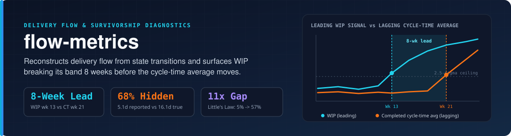
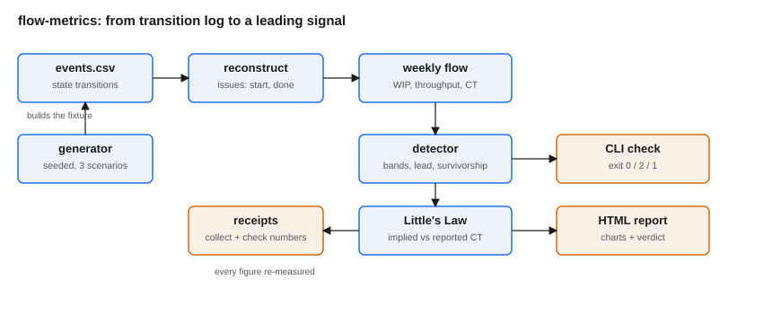
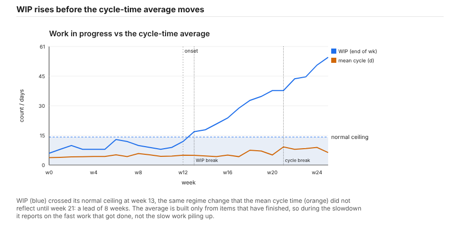
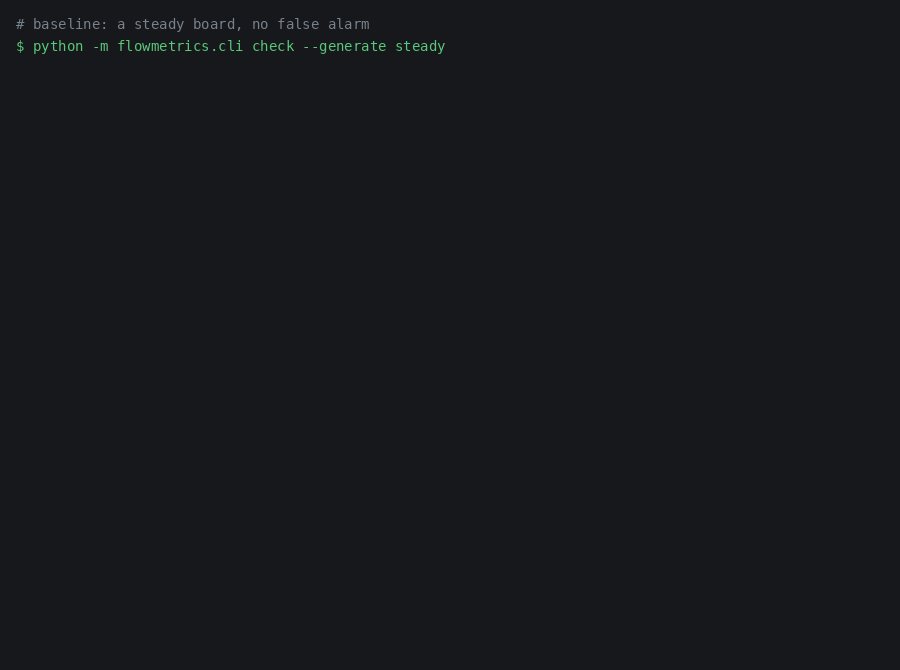

<div align="center">
  
</div>

# flow-metrics

**Reconstructs delivery flow from Jira-style state transitions and shows work in progress breaking its normal band a full lead of 8 weeks before the cycle-time average a team watches ever moves.**

[](https://github.com/Venkata-Pramid-Reddy-Mitta/flow-metrics/actions/workflows/ci.yml)


[](https://Venkata-Pramid-Reddy-Mitta.github.io/flow-metrics/)

A sprint board reports a mean cycle time. It is the number teams trend, gate on, and put in front of stakeholders. The problem is structural, not cosmetic: a mean cycle time is computed only from items that have **finished**, so during a slowdown it reports on the fast work that got done while the slow work piles up unfinished and uncounted. The number that is supposed to warn you is blind to the warning until the warning is over.

## Four questions this answers that a cycle-time chart cannot

1. Is a slowdown already building this week, before the average that is supposed to report it has moved at all?
2. How far does the reported average understate what the work alive right now will actually cost, once it finishes?
3. Does the relationship between work in progress, throughput and cycle time (Little's Law) still hold, and if not, which way is it breaking?
4. At the moment the alarm fires, can the tool tell a real regime change from a temporary burst that will clear on its own?

## The numbers, including the ones I would rather not publish

On a seeded 26-week board with a capacity drop in week 12:

- The cycle-time average **understated** what the work alive that week would eventually cost **by 68%**: it reported a mean cycle time of 5.1 days while that work went on to take 16.1 days. The tool's own normal output, and a real dashboard, lies in exactly this direction, and only hindsight shows it.
- Work in progress broke its band at week 13; the cycle-time average did not cross until week 21. That is a **lead of 8 weeks**, and the average stayed **flat for 6 weeks** after WIP was already over its ceiling.
- Little's Law tracks the reported average to **within 5% in steady state** and diverges **to 57% during the transition**, a gap **11 times wider**.
- The uncomfortable boundary: a transient burst that clears trips the **same** alarm as a permanent slowdown. The two cannot be told **apart until week 18**, so at the moment of the alarm the tool cannot tell you which it is. That is **5 weeks of ambiguity** it cannot remove.

Every figure above is re-measured by **108 tests** at **100% line coverage** plus four experiments, and guarded by `tools/check_numbers.py`, which fails the build if any number here drifts from what the code produces. Break one figure on purpose and `make verify` goes red.

## Quickstart

Prerequisites: Python 3.9 or newer. No network, no API keys, no services.

```bash
git clone https://github.com/Venkata-Pramid-Reddy-Mitta/flow-metrics.git
cd flow-metrics
python -m pip install -e ".[dev]"

# The headline: run the detector on the committed slowdown fixture.
python -m flowmetrics.cli check            # prints the lead, exits 2 on a signal

# Rebuild the HTML report and re-verify every published number, offline.
make verify
```

`flow-metrics check` exits `2` when it finds a leading slowdown signal, `0` when it does not, and `1` only when it could not run at all. The three codes are the contract a CI gate relies on.

## What WIP sees that the average does not

| | week of the break | what it is built from |
|---|---|---|
| WIP (leading) | 13 | every item open right now, finished or not |
| cycle-time average (lagging) | 21 | only items that have already finished |

WIP rises the moment commitments outrun capacity, because an unfinished item is still WIP. The completed-cycle average cannot rise until the slow items finish, and under pressure a team clears its quick wins first, so for weeks the only items finishing are the fast ones. The average keeps reporting a healthy number built from a biased sample. The lead of 8 weeks is the distance between those two columns.

## What the average hid: survivorship

The completed-cycle mean excludes every item still open, which during a slowdown is exactly the set that is aging. So the number is not merely late, it is biased downward when it matters most.

| at the worst week (week 20) | days |
|---|---|
| reported mean cycle time (completed items) | 5.1 |
| eventual mean of the work alive that week | 16.1 |
| understatement | 68% |

The eventual figure needs hindsight: you only learn it once that work finishes. That is the point. The in-the-moment number a team acts on understated the real experience by 68%, and nothing in the completed-cycle average could have revealed it.

## Little's Law as an independent cross-check

Little's Law relates average WIP, throughput and cycle time: `cycle time = WIP / throughput`. It turns WIP and throughput, both known in the moment, into a second estimate of cycle time that needs no hindsight. While the board is stable the two agree; once demand outruns capacity the implied cycle time climbs at once while the reported one stays flat.

| | mean absolute divergence |
|---|---|
| steady state | within 5% |
| the transition | 57% |
| ratio | 11 times wider |

The cost-vs-buy of the detector's main knob:

| what it costs | what it buys |
|---|---|
| a 3-week persistence rule delays the signal by up to 3 weeks | zero false alarms on the steady fixture, so a fired signal always means WIP genuinely broke its band |

## The bugs the measurement found

**Little's Law looked broken in a stable system.** The first implementation divided the end-of-week WIP **snapshot** by throughput, which yields a divergence of 26% on the steady fixture: the law appeared broken where nothing was wrong. A snapshot samples a fluctuating count; Little's Law relates to the time-average. Switching to a daily time-averaged WIP dropped the steady divergence to about 5%, roughly five times tighter. Pinned in `test_regressions.py::test_littles_law_uses_time_averaged_wip_not_the_end_of_week_snapshot`, and recorded in [ADR-003](docs/adr/ADR-003-trend-band-not-control-chart.md).

**The survivorship scan crowned a baseline fluke.** The worst-week search first returned a quiet baseline week, driven by one long-pole item among a handful of completions. Noise, not signal. The fix restricts the scan to post-baseline weeks and requires a minimum cohort, pinned in `test_regressions.py::test_survivorship_worst_week_is_not_a_small_sample_baseline_fluke`.

## Architecture



```diagram-source
events.csv -> reconstruct issues -> weekly flow (WIP, throughput, cycle time)
weekly flow -> detector (bands, lead, survivorship) -> CLI check (exit 0/2/1)
weekly flow -> Little's Law (implied vs reported) -> HTML report
generator (seeded, 3 scenarios) -> events.csv
receipts (collect + check numbers) re-measures every published figure
```

## Evidence

Framed from the real HTML report by `tools/capture_screenshots.py`, which also reads back the verdict badge's computed color and fails if it is illegible.



The screenshot tool and the report share one analysis path, so the figures in the image are the same figures `check_numbers.py` guards. The manifest at `docs/screenshots/manifest.json` records which headings framed each shot.

A replay of the real CLI, paced by each command's measured wall time (a replay, not a screen recording):



Every line is captured stdout, never hand written. The baseline exits `0`, the headline check exits `2`, and the receipts step closes it out. The manifest at `docs/video/manifest.json` lists each command with its exit code and duration, and `docs/video/demo.mp4` is the same replay at higher quality.

## The fixture

The default input, `data/events.csv`, is a seeded, deterministic transition log for a 26-week board that peaks at 55 items in progress. It begins mid-flight: a 42-day burn-in runs before week 0 so the detector's baseline learns a genuine steady state rather than a cold-start transient. The awkward cases are deliberate:

- A **steady** scenario with no regime change, which the detector must leave silent (it does: no false alarm).
- A **transient burst** that trips the same alarm as the real slowdown and then recovers, which exists to prove the tool cannot tell the two apart in the moment.
- Lumpy item sizes, so some long-pole items starve under overload. A board of identical small items would never produce the survivorship gap.

`make fixture` rebuilds the CSV from the seed, and a test fails if the committed file and a fresh generation ever disagree.

## What this cannot measure

- **It cannot distinguish a regime change from a transient burst in real time.** Both push WIP over its band at essentially the same week; they cannot be told apart until week 18, which is 5 weeks of ambiguity after the alarm. The tool flags that flow has broken its band, not that a slowdown is permanent. See [ADR-004](docs/adr/ADR-004-boundary-transient-vs-permanent.md).
- **The lead is a property of the assumed service discipline.** The fixture models a team that triages toward the work closest to done. Under a strict oldest-first discipline the lead would be smaller, because aged items are forced to completion sooner. The number is real but it is not a universal constant. See [ADR-002](docs/adr/ADR-002-service-discipline.md).
- **It does not model blocked or in-review states.** Time there is folded into in_progress by design, so this cannot attribute a slowdown to a specific stage. See [ADR-001](docs/adr/ADR-001-three-state-model.md).
- **The onset week is declared in the fixture, not discovered.** The detector never reads it; it is used only to mark the chart and to choose the steady and transition spans the divergence is compared over.

## Layout, exit codes, and reproduction

```
src/flowmetrics/   model, generator, flow, littles, detector, analysis, report, cli, charts
tests/             108 tests, property-named, pinning two real bugs
experiments/       four experiments writing JSON to docs/experiments/
tools/             collect_metrics, check_numbers, render_diagram, capture_screenshots
data/              the committed, seeded event fixtures
docs/              banner.svg, index.html (GitHub Pages), metrics.json, adr/, diagrams/, screenshots/, video/
```

Exit codes from `flow-metrics check`:

- `0`: ran, no leading slowdown signal in the window.
- `2`: ran, a leading slowdown signal was detected (usable as a gate).
- `1`: the tool failed to answer (bad input, missing file).

The distinction between `2` and `1` is deliberate: a crashed tool must not read as "all clear".

Make targets: `make test`, `make lint`, `make receipts`, `make fixture`, `make evidence`, and `make verify` (lint, tests, receipts) which must pass from a fresh clone with no network. `check_numbers.py` matches anchor **phrases** rather than bare digits, because searching for a digit passes a sentence that has gone stale around it.

## Tech stack

| Technology | Role here | Why this choice |
|---|---|---|
| Python standard library | the whole runtime library and CLI | zero runtime dependencies, so `make verify` runs offline and reproduces every number |
| `random.Random` (stdlib) | the seeded generator | its stream is stable across Python versions, unlike a numpy generator whose defaults have shifted between releases |
| pytest + coverage | the suite and the coverage floor | property-named tests, measured at 100% line coverage, enforced in CI |
| ruff | lint | one fast linter, line length held at 100 |
| hand-built SVG | charts and the architecture diagram | deterministic and valid XML, so it embeds on GitHub where a Mermaid fence sometimes fails to render |
| Playwright + Chromium | report screenshots | the only stage that sees rendered pixels, used to verify the verdict badge is legible |

Five decisions, recorded as ADRs:

- [ADR-001](docs/adr/ADR-001-three-state-model.md): a three-state flow model, and what folding blocked and review into in_progress costs.
- [ADR-002](docs/adr/ADR-002-service-discipline.md): shortest-remaining-first service, and how much the lead shrinks under oldest-first.
- [ADR-003](docs/adr/ADR-003-trend-band-not-control-chart.md): a trend band rather than a control chart, and why the sibling raid-signal project owns SPC.
- [ADR-004](docs/adr/ADR-004-boundary-transient-vs-permanent.md): the boundary the tool cannot cross, transient versus permanent.
- [ADR-005](docs/adr/ADR-005-seeded-fixture-not-live-jira.md): a seeded fixture rather than a live Jira export, and the one claim that would need the real thing.

## The Pivot and future work

Intentionally out of scope: a live Jira importer. The trigger to add it is the first time someone wants to run the detector on a real board rather than the fixture; until then an importer adds credentials, network and flakiness that buy nothing the fixture cannot demonstrate (ADR-005).

A v2 would need:

- A real Jira export mapped onto the transition model, with the first metric to watch being whether the steady-state Little's Law divergence stays near 5% on real data or whether real boards are noisier.
- A per-stage model (blocked, in review) so a slowdown can be attributed to a stage, not just detected.
- An online detector that updates the band as the baseline shifts, rather than learning it once.

## License

MIT, see [LICENSE](LICENSE). Copyright 2026 Venkata Pramid Reddy Mitta.
